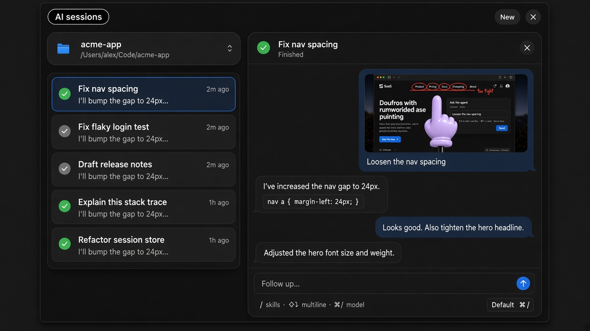

  

# AiHand

A tiny hand for demos — and a draw-to-agent loop for Cursor, Claude Code, and Codex.

Forked from [nilbuild/tinyhand](https://github.com/nilbuild/tinyhand).

  
  

## What it does

- **Point & tap** — a toy hand follows the cursor; clicks stay visual, not real
- **Draw** — freehand, rectangle, arrow, and text; thickness and ink color; lines can fade
- **Screenshot annotate** — draw on screen or a window, comment, and send to Cursor Agent, Claude Code, or Codex
- **Video annotate** — right-drag a region, record it, then comment or send the clip to an agent (preview plays at the capture spot)
- **AI sessions** — chat, follow-ups, skills (`/`), favorite models, and per-folder working directories

<strong>Draw → ask the agent</strong>

<strong>AI sessions</strong>

## Shortcuts

### Global

| | |
|---|---|
| **⌘⇧H** | Pointer on / off |
| **⌘⇧G** | AI sessions panel |
| **⌘,** | Settings |

### Drawing mode

| | |
|---|---|
| Click / drag | Tap / draw |
| **F** / **R** / **A** / **T** | Freehand / rectangle / arrow / text |
| **1–5** | Stroke thickness |
| **⌘Z** | Undo |
| **⌘⇧X** | Clear drawing |
| **⌘⇧S** | Save annotated screenshot |
| **⌘⇧C** | Copy annotated screenshot |
| **⌘B** | Capture screen ↔ window |
| **⌘/** | Cycle agent model (chat / annotate comment) |
| **Enter** | Comment, then send to agent |
| **⌘↩** | Send annotated screenshot to agent |
| **Right-drag** | Enter video mode (select region) |
| **Esc** | Exit pointer |

### Video mode

| | |
|---|---|
| Release right button | Start recording the selected region |
| **Stop** | Finish recording (keep clip) |
| **⌘S** | Save video, preview + comment, then send |
| **⌘⇧S** | Save video (drag preview into other apps) |
| **⌘↩** | Save and send video to agent |
| **Esc** | Cancel selection / discard recording / delete video while commenting |

## Install

macOS 13+, Apple silicon and Intel. Open the DMG, drag to Applications, allow **Accessibility** (and Screen Recording for captures). Updates itself.

## License

MIT. See [LICENSE](LICENSE).
