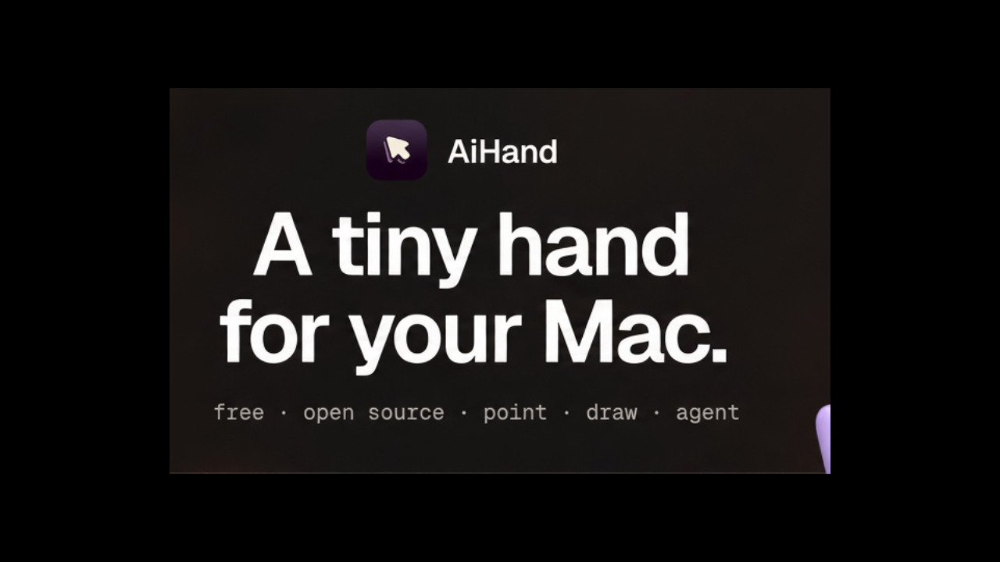
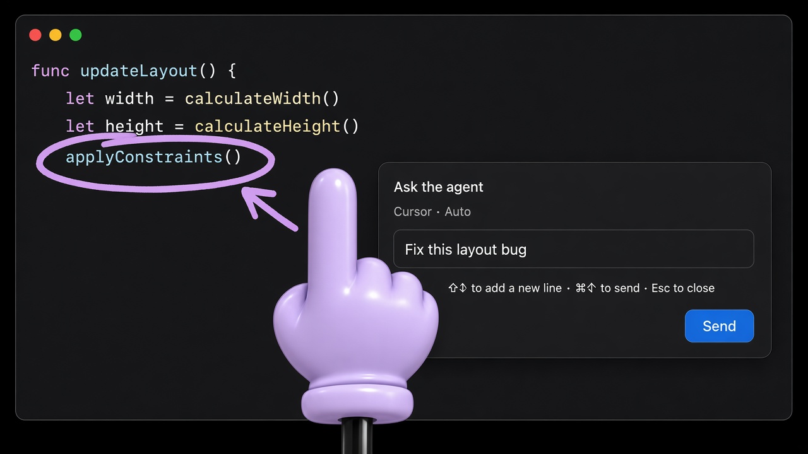
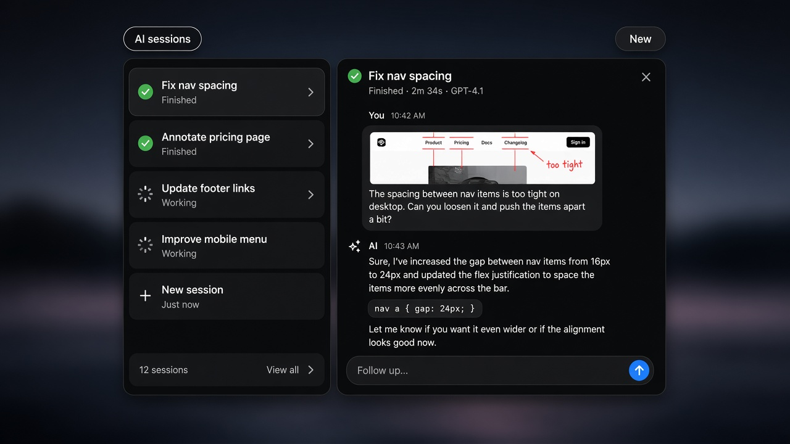
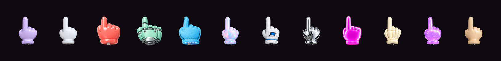

  

# AiHand

A tiny hand for demos — and a draw-to-agent loop for Cursor, Claude Code, and Codex.

Forked from [nilbuild/tinyhand](https://github.com/nilbuild/tinyhand).

  
  

## What it does

- **Point & tap** — a toy hand follows the cursor; clicks stay visual, not real
- **Draw** — hold and drag; lines fade; ink can match the hand
- **Send to an agent** — annotate the screen, then hand off to Cursor Agent, Claude Code, or Codex
- **AI sessions** — chat, follow-ups, skills (`/`), and per-folder working directories

<strong>Draw → ask the agent</strong>

<strong>AI sessions</strong>

## Shortcuts

| | |
|---|---|
| **⌃⌥H** | Pointer on / off |
| Click / drag | Tap / draw |
| **⌃⌥X** | Clear drawing |
| **⌘⇧G** | AI sessions panel |
| **Esc** | Clear and turn off |

## Install

macOS 13+, Apple silicon and Intel. Open the DMG, drag to Applications, allow **Accessibility** (and Screen Recording for captures). Updates itself.

## License

MIT. See [LICENSE](LICENSE).
